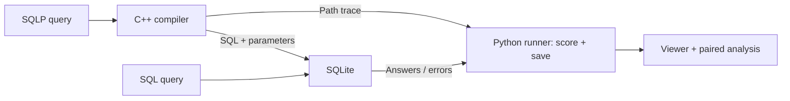

# SQLP for AI Agents: Correctness and Token Efficiency

[](https://github.com/somehowe/sqlp-agents/actions/workflows/offline-checks.yml)

A C++ compiler and experiment tools for comparing SQL and SQLP queries generated
by AI agents. SQLP expresses navigation through named relationships, such as
`w.author.university.country`. The compiler translates these paths into SQL and
parameters; **SQLite executes both conditions**.

**Research question:** Given equivalent schema and relationship information, how
does using SQLP instead of SQL affect AI agents' query correctness and total token
usage?

**SQLP Path Studio** makes the language visible: follow a named path through a
branching graph, inspect its exact SQL joins, open real table samples, and see
how editing a relationship changes the answer. It runs locally without model
calls. The [exploratory results](docs/STUDY_RESULTS.md) include corrected NatSQL
comparisons, shared-context batches, longer paths, and join-view controls.
Human interpretation review is pending; the 30 reserved questions remain unrun.

## Quick start

Requirements:

- GNU Make 4.3+, a C++20-capable `g++`, and Bison 3.8+.
- Python 3.11+ with its standard-library SQLite module and SQLite serialization
  support for frozen snapshots.
- Node.js 18+ for the optional viewer checks. The viewer itself runs in a browser.

From the repository root:

```bash
make
python3 -m tools.demo_bundle build/lab-demo
python3 -m tools.demo_server --bundle build/lab-demo/bundle.json \
  --compiler build/lab-demo/sqlpc --port 8765
```

Open `http://127.0.0.1:8765/`. Choose a scenario, edit a SQLP path, and click
**Run**. Select a path to highlight its joins, use **Follow path** to step through
its roles, and click a table for real sample records. Switch to **Catalog map**
to explore supplied relationships or change snapshots to expose answer mistakes.
SQL uses the same read-only scorer. Stop the server with Ctrl+C.

This default bundle contains **prepared synthetic examples**, including a
deliberate duplicate-handling mistake. It makes no model calls and invents no
token usage. Recorded model runs are separate evidence. No API key, downloads,
or Python packages are needed. Use a **new output folder** each time.
See [the interactive lab](docs/DEMO_LAB.md).

The original end-to-end offline example is also available:

```bash
python3 -m tools.offline_example build/offline-example
```

It creates prepared and deliberately incorrect examples, a frozen kit, planned
requests, synthetic replay, and paired analysis. To open these saved records:


```bash
python3 -m http.server 8000 --bind 127.0.0.1 --directory web
```

Open `http://127.0.0.1:8000` and choose
`build/offline-example/replay-report.json`. Select a question, compare queries and
answers, expand the saved requests/responses, and inspect a SQLP path's join
mapping. `demo/prepared-report.json` and `demo/deliberate-report.json` in the same
example folder show the reference queries and explicitly introduced mistakes.
The viewer reads local files; it does not generate queries or call a model.

See [the complete example](docs/OFFLINE_EXAMPLE.md) and
[viewer instructions](docs/VIEWER.md).

## How SQLP works

For the academic fixture, this query follows approved author and university
relationships:

```sql
SELECT DISTINCT w.author.name
FROM WROTE w
WHERE w.author.university.country = 'CA';
```

The catalog defines `WROTE.author_aid = AUTHOR.aid` and
`AUTHOR.uni_id = UNIVERSITY.uid`. The compiler expands the path into those joins
and binds `CA` as a parameter. The SQL condition writes the joins using the same
relationship facts. Choosing the right path still matters: an author's
university country and a paper's publisher country can give different answers.



The supported subset includes projections, one FROM binding with an alias,
finite multi-hop paths, literal equality, AND, DISTINCT, typed parameters, and
path-to-join traces. Broader SQLP features, aggregates, OR, correlated EXISTS,
UNION, and multiple FROM bindings are outside the current profile. See
[the compiler interface](docs/COMPILER_CLI.md) for exact syntax and limits.

## What is built

| Component | Current behavior |
| --- | --- |
| [C++ frontend](docs/COMPILER_CLI.md) | Tokenizer, Bison parser, query AST, name/type checks, path compilation, parameterized SQL, and translation traces |
| [Dataset tools](docs/DATASET_CHECKS.md) | Inspect SQLite schemas and validate actual types, keys, and total references |
| [Restricted ARM layer](docs/ARM_MAPPING.md) | Validate reviewed single-key mappings and create logical SQLite views/catalog; inspired by the Abstract Relational Model (ARM) |
| [Python runner](docs/MODEL_PILOT.md) | Score prepared pairs; plan, replay, or make explicit live SQL/SQLP requests; load private credentials, preserve reasoning settings, journal responses and raw usage/status |
| [Batch runner](docs/BATCH_PILOT.md) | Share context across questions with a JSON batch-size-1 control; count actual whole-response usage once |
| [NatSQL condition](docs/NATSQL.md) | Generate NatSQL, run the pinned official converter under a declared schema profile, and retain conversion/wrong-answer failures |
| [Study tools](docs/EXPERIMENT_KIT.md) | Freeze inputs/runtime, export [review packets](docs/REVIEW_PACKET.md), analyze paired records, and measure prepared-query sizes/timings |
| [Contrasting data](docs/SNAPSHOT_EVALUATION.md) | Re-execute saved queries on supplied alternate snapshots; expose accidental agreement without new model calls |
| [Join-view control](docs/JOIN_VIEWS.md) | Generate workload-independent flattened views and expose the same facts to both languages |
| [Path Studio](docs/DEMO_LAB.md) | Branching role/alias graph, join highlighting, animated path steps, catalog map, real table previews, duplicate-sensitive answers, and recorded token charts; no model calls |
| [Browser viewer](docs/VIEWER.md) | Display saved queries, answers, diagnostics, tokens, path mappings, and optional ARM mapping artifacts using plain HTML/CSS/JavaScript |

The public sample workload uses a pinned **Chinook sample-store database**: nine
tables, 6,874 rows, 12 development questions, and 30 reserved questions. Its 42
prepared pairs pass both directly and through generated ARM views. These are the
same questions in two setups, with human interpretation review still pending.
The study also uses 32 related synthetic path templates at depths 1, 2, 4, and 6,
with two catalog widths and three valid snapshots. These are controlled cases,
not independent databases. See [the workload](docs/WORKLOAD.md) and
[controlled path study](examples/path_study/README.md).

Data-lake discovery remains a possible extension. The current system receives
approved relationships; it does not discover connections automatically. The
optional [NatSQL condition](docs/NATSQL.md) now has actual recorded model results.
It uses a documented structural schema adapter rather than the full published
NatSQL preprocessing pipeline.

## Evaluation

Each comparison uses the same model/settings, questions, data, and
relationship facts, with a corresponding guide for each language. The current
runner uses one attempt per condition. It checks expected values and duplicate
counts and records all provider-reported input/output tokens, including guides
and schema. Missing usage stays unknown. A repair loop is not implemented.

The corrected three-language comparison uses two corresponding examples per
guide. SQLP used 0.32–0.53% more total tokens than SQL on separate requests;
NatSQL converted all 108 outputs, with 36/36 answer matches for Sol/Astra and
33/36 for Luna. The earlier guide incorrectly omitted native flat `IN` and its
108 calls are preserved as superseded calibration, not evidence of superiority.

In the original fixed-guide JSON batches, twelve questions sharing context used
3.12–10.71% fewer SQLP tokens, with all answers matching in both languages.
Guide versions and protocols stay separate. These bounded observations do not
establish general accuracy gains or an intrinsic language-token advantage.
See [the full results](docs/STUDY_RESULTS.md), [NatSQL details](docs/NATSQL.md),
and [credential setup](docs/CREDENTIALS.md) before any live run.

## Build and checks

```bash
make -j2 all test
make test-viewer
```

The first command builds both executables and runs the C++ suites, 360 Python
tests, and 1,200 differential compiler cases. Optional integrations skip when
their separate inputs are absent. The second runs 61 Node checks across the
saved viewer and interactive lab, without packages. A Chromium walkthrough
also passed 26 browser-check categories; conference rehearsal still needs human review.
GitHub Actions runs the offline suites and exercises the viewer with generated
prepared, deliberate-error, and replay reports.

`make run` retains the original small path demo and prints `w.author.name`.
Use the offline example above for the complete workflow. Optional sanitizer and
mutation checks are described in [COMPILER_CHECKS.md](docs/COMPILER_CHECKS.md).

## Repository guide

- `src/`: C++ compiler and original path demo.
- `tools/`: Python dataset, execution, experiment, and analysis tools.
- `prompts/`: corresponding SQL, SQLP, and NatSQL language guides.
- `examples/`: academic fixtures, ARM mappings, Chinook definitions, and the
  controlled path-study guide.
- `web/`: saved-record viewer and interactive query lab.
- `tests/`: compiler, protocol, data, analysis, and viewer checks.
- `docs/`: [project direction](docs/IDEA.md), [agent context](docs/AGENTS.md),
  [delivery schedule](docs/SCHEDULES/SCHEDULE.md), and component guides.

Generated experiments, private reference material, and paper drafts remain in
Git-ignored `build/` and `resources/` directories.

## Related work

| Paper | Connection |
| --- | --- |
| [The Utility of the Abstract Relational Model and Attribute Paths in SQL](https://pubs.cs.uct.ac.za/id/eprint/1276/1/ersqlpathEKAW18.pdf) | SQLP/ARM foundations and human query-authoring/comprehension studies |
| [NatSQL: Natural SQL](https://aclanthology.org/2021.findings-emnlp.174/) | A simplified intermediate representation for text-to-SQL generation |
| [Qualitative Join Discovery in Data Lakes using Examples](https://mirmahathir.com/papers/semdisc.pdf) | SemDisc join discovery; context for a possible future data-lake extension |
