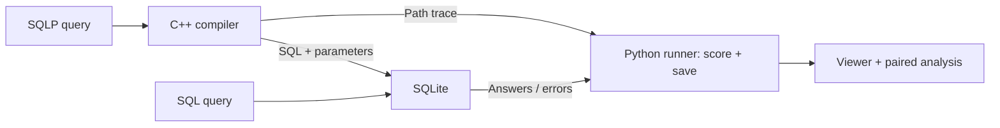

# SQLP for AI Agents: Correctness and Token Efficiency

[](https://github.com/somehowe/sqlp-agents/actions/workflows/offline-checks.yml)

A C++ compiler and experiment tools for comparing SQL and SQLP queries generated
by AI agents. SQLP expresses navigation through named relationships, such as
`w.author.university.country`. The compiler translates these paths into SQL and
parameters; **SQLite executes both conditions**.

**Research question:** Given equivalent schema and relationship information, how
does using SQLP instead of SQL affect AI agents' query correctness and total token
usage?

The offline workflow is implemented. Real model experiments, human review of the
study answers, and visual browser testing are still pending. Prepared queries,
synthetic replay, and static token counts are development evidence; we have not
established an agent accuracy or token-efficiency advantage.

## Quick start

Requirements:

- GNU Make 4.3+, a C++20-capable `g++`, and Bison 3.8+.
- Python 3.11+ with its standard-library SQLite module and SQLite serialization
  support for frozen snapshots.
- Node.js 18+ for the optional viewer checks. The viewer itself runs in a browser.

From the repository root:

```bash
make
python3 -m tools.offline_example build/offline-example
```

This creates six prepared query pairs, deliberately incorrect examples, a frozen
experiment kit, twelve planned requests, synthetic replay, and paired analysis.
It requires no API key, downloads, or Python packages. Use a **new output folder**
for each run; existing results are preserved.

To inspect the records, serve the static viewer:

```bash
python3 -m http.server 8000 --bind 127.0.0.1 --directory web
```

Open `http://127.0.0.1:8000` and choose
`build/offline-example/replay-report.json`. Select a question, compare queries and
answers, expand the saved requests/responses, and inspect a SQLP path's join
mapping. `demo/prepared-report.json` and `demo/deliberate-report.json` in the same
example folder show the reference queries and explicitly introduced mistakes.
The viewer reads local files; it does not generate queries or call a model.

See [the complete example](docs/OFFLINE_EXAMPLE.md) and
[viewer instructions](docs/VIEWER.md).

## How SQLP works

For the academic fixture, this query follows approved author and university
relationships:

```sql
SELECT DISTINCT w.author.name
FROM WROTE w
WHERE w.author.university.country = 'CA';
```

The catalog defines `WROTE.author_aid = AUTHOR.aid` and
`AUTHOR.uni_id = UNIVERSITY.uid`. The compiler expands the path into those joins
and binds `CA` as a parameter. The SQL condition writes the joins using the same
relationship facts. Choosing the right path still matters: an author's
university country and a paper's publisher country can give different answers.



The supported subset includes projections, one FROM binding with an alias,
finite multi-hop paths, literal equality, AND, DISTINCT, typed parameters, and
path-to-join traces. Broader SQLP features, aggregates, OR, correlated EXISTS,
UNION, and multiple FROM bindings are outside the current profile. See
[the compiler interface](docs/COMPILER_CLI.md) for exact syntax and limits.

## What is built

| Component | Current behavior |
|---|---|
| [C++ frontend](docs/COMPILER_CLI.md) | Tokenizer, Bison parser, query AST, name/type checks, path compilation, parameterized SQL, and translation traces |
| [Dataset tools](docs/DATASET_CHECKS.md) | Inspect SQLite schemas and validate actual types, keys, and total references |
| [Restricted ARM layer](docs/ARM_MAPPING.md) | Validate reviewed single-key mappings and create logical SQLite views/catalog; inspired by the Abstract Relational Model (ARM) |
| [Python runner](docs/MODEL_PILOT.md) | Score prepared pairs; plan or replay separate SQL/SQLP requests; journal responses and preserve raw usage/status. An explicit live adapter is implemented but unused |
| [Study tools](docs/EXPERIMENT_KIT.md) | Freeze inputs/runtime, export [review packets](docs/REVIEW_PACKET.md), analyze paired records, and measure prepared-query sizes/timings |
| [Browser viewer](docs/VIEWER.md) | Display saved queries, answers, diagnostics, tokens, path mappings, and optional ARM mapping artifacts using plain HTML/CSS/JavaScript |

The current study workload uses a pinned **Chinook sample-store database**: nine
tables, 6,874 rows, 12 development questions, and 30 reserved questions. Its 42
prepared pairs pass both directly and through generated ARM views. These are the
same questions in two setups, with human interpretation review still pending.
See [the workload](docs/WORKLOAD.md).

Data-lake discovery remains a possible extension. The current system receives
approved relationships; it does not discover connections automatically. The
optional [NatSQL adapter](docs/NATSQL.md) runs a pinned external converter, but a
matched third model condition is not implemented.

## Evaluation

The planned comparison uses the same model/settings, questions, data, and
relationship facts, with a corresponding guide for each language. The current
runner uses one attempt per condition. It checks expected values and duplicate
counts and records all provider-reported input/output tokens, including guides
and schema. Missing usage stays unknown. A repair loop is not implemented.

Shorter query text alone does not establish lower total model usage. The
[offline microbenchmarks](docs/OFFLINE_BENCHMARKS.md) measure prepared-query text
and execution separately from model performance. Real runs still require model
access, an agreed spending limit, and reviewed study inputs.

## Build and checks

```bash
make -j2 all test
make test-viewer
```

The first command builds both executables and runs the C++/Python suites plus
1,200 differential compiler cases. The second needs Node.js and checks the local
viewer without packages. Tests for the external NatSQL environment, downloaded
Chinook source, and local tokenizer vocabulary skip when those inputs are absent.
GitHub Actions runs the offline suites and exercises the viewer with generated
prepared, deliberate-error, and replay reports.

`make run` retains the original small path demo and prints `w.author.name`.
Use the offline example above for the complete workflow. Optional sanitizer and
mutation checks are described in [COMPILER_CHECKS.md](docs/COMPILER_CHECKS.md).

## Repository guide

- `src/`: C++ compiler and original path demo.
- `tools/`: Python dataset, execution, experiment, and analysis tools.
- `prompts/`: corresponding SQL and SQLP language guides.
- `examples/`: academic fixtures, ARM mappings, and Chinook workload definitions.
- `web/`: local saved-record viewer.
- `tests/`: compiler, protocol, data, analysis, and viewer checks.
- `docs/`: [project direction](docs/IDEA.md), [agent context](docs/AGENTS.md),
  [delivery schedule](docs/SCHEDULES/SCHEDULE.md), and component guides.

Generated experiments, private reference material, and paper drafts remain in
Git-ignored `build/` and `resources/` directories.

## Related work

| Paper | Connection |
|---|---|
| [The Utility of the Abstract Relational Model and Attribute Paths in SQL](https://pubs.cs.uct.ac.za/id/eprint/1276/1/ersqlpathEKAW18.pdf) | SQLP/ARM foundations and human query-authoring/comprehension studies |
| [NatSQL: Natural SQL](https://aclanthology.org/2021.findings-emnlp.174/) | A simplified intermediate representation for text-to-SQL generation |
| [Qualitative Join Discovery in Data Lakes using Examples](https://mirmahathir.com/papers/semdisc.pdf) | SemDisc join discovery; context for a possible future data-lake extension |
