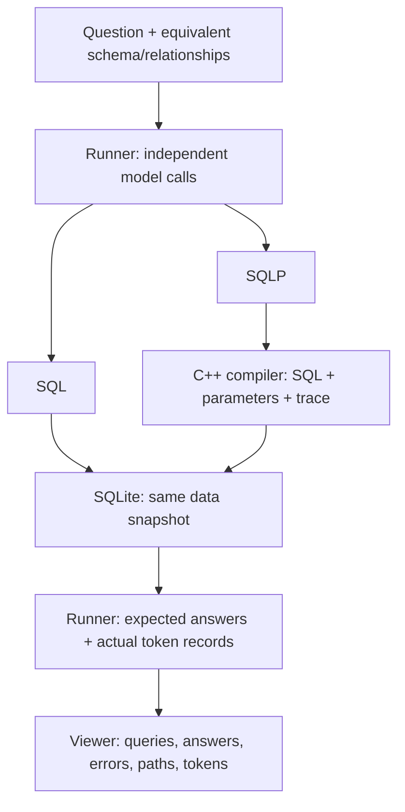

# SQLP for AI Agents: Correctness and Token Efficiency

The idea is to see how using SQLP affects an AI agent's query correctness and token usage. The runner gives the same model a question separately in SQL and SQLP conditions, executes both against the same data, and compares answers and total tokens. The current website opens saved comparison records; live question entry is a possible later extension.

**Research question:** Given equivalent schema and relationship information, how does using SQLP instead of SQL affect AI agents' query correctness and total token usage?

I think this gives us a concrete question while keeping the compiler work useful. SQLP could make joins easier to express, but models already know SQL and would need instructions for SQLP. Our [first development runs](PILOT_RESULTS.md) found shorter generated queries without lower total token usage. We still need reviewed answers and a reserved-question comparison before making a broader claim.

## How the joins work

Suppose we want the authors of recorded papers who work at universities in Denmark. With approved relationships between authorship records, authors, and universities, the model could write:

```sql
SELECT DISTINCT w.author.name
FROM WROTE w
WHERE w.author.university.country = 'DK';
```

Our C++ compiler would translate that into SQL like this, supplying `DK` separately as a parameter:

```sql
SELECT DISTINCT a.name
FROM WROTE AS w
JOIN AUTHOR AS a ON w.author_aid = a.aid
JOIN UNIVERSITY AS u ON a.uni_id = u.uid
WHERE u.country = ?;
```

In the SQL condition, the model writes the joins itself using the same relationship facts. In the SQLP condition, it chooses the path and our compiler constructs the joins. **SQLite executes both.** The compiler now supports this multi-hop behavior.

The model still has to choose the right relationship. Following a paper's publisher country instead of its author's university country could produce a valid query with the wrong answer. I think choosing the right relationship role, especially as paths get longer, is an interesting part to test.

## How the pieces fit

The C++ compiler translates SQLP. The Python runner calls the model, compiles
SQLP, executes both conditions in SQLite, and checks answers. The [local viewer](VIEWER.md) displays those saved records and path-to-join mappings.

Ryan currently handles the required compiler, runner, and viewer work. Sam is
planning a separate paper, and Iris has discussed a possible data-lake extension.
Neither direction is implemented here. Help reviewing answers or the demo can
still fit alongside those projects; specific tasks need agreement. This is
separate from deciding authorship.



## What the demo would show

Someone opens a saved run in the [local viewer](VIEWER.md) and chooses a question.
They see both queries, SQLP's translation, answers, errors, and tokens. Selecting
a path shows the exact tables and join columns it follows. This helps explain
where the two attempts used different relationships. Live question entry can
come later; the current viewer reads recorded runs.

The Chinook prepared queries are checked against separate Python answer plans;
the academic fixture uses manually prepared expected answers. We still need a
person to review that the study questions and answers mean what we intend. The
[review packets](REVIEW_PACKET.md) make those questions, paths, and answer bags
readable and provide a blank notes sheet. Arbitrary questions remain unscored
until we know the correct answer. Agreement between SQL and SQLP alone doesn't
prove correctness; both can be wrong.

## How we test it

Use the same model/settings, questions, data, and approved relationships. Give each condition a corresponding language guide. Count **all provider-reported input/output tokens**, including instructions, schema, and any retries. Start with one attempt per condition. A shorter query can still use more total tokens because of guide overhead or other generated text. Token counts do not directly measure thinking time.

SQLP's human study motivates the question. NatSQL already simplifies model-generated queries. Its converter now runs in a separate environment, but our manual checks found failures on some longer paths and repeated relationship roles. Those are implementation observations, not an agent comparison. A third model condition still needs a matched guide and agreed scope, so it remains optional. The goal is an honest comparison, whichever language performs better.

## The ARM mapping layer

The small ARM layer connects this more directly to Enamul's work. It now takes
reviewed entity/role names and declared keys/relationships, validates them, and
builds a logical schema plus SQLite views over existing tables. Our compiler
queries those views using the current SQLP syntax. The demo can show how a named
relationship reaches stored data.

This is implemented for single-column non-null keys, total references, and
literal answers. It preserves duplicate relationship records with explicit
keys. It does not discover which real-world records are the same entity or
implement the full thesis. SQL gets equivalent views and facts if we use this
layer in the study. See [ARM_MAPPING.md](ARM_MAPPING.md) for the exact subset.

## Scope for this submission

The compiler, prepared comparison, pilot/replay runner, viewer, analyzer, and
restricted ARM layer work offline. An [experiment kit](EXPERIMENT_KIT.md) freezes
their inputs and runtime, checks prepared answers, and produces exact requests
without contacting a model. The live adapter has now been used for real paired
development runs, with private credentials and matched model/reasoning settings.
Prepared/replay runs remain separate from those actual model results.

The current [workload](WORKLOAD.md) uses a pinned Chinook sample-store database:
nine tables, 6,874 rows, 12 development questions, and 30 reserved questions.
All 42 prepared SQL/SQLP pairs pass both directly and through generated ARM views.
These are the same questions in two setups. Human answer review is still pending.
Chinook is not a data lake. **We supply approved relationships to both conditions**;
automatic discovery remains a later extension.

One offline observation is already useful: on the 12 Chinook development
questions, a local tokenizer counted fewer tokens in the prepared SQLP queries,
but the longer guide canceled that saving across guide, task, and query text.
Those static counts are separate from actual model usage. The real pilot also
found that guide overhead outweighed shorter output on these questions. We also
found an answer that matched the original data but failed when two albums shared
a title. The next priority is checking question meanings and answers, then
freezing the main comparison. See [the results and limitations](PILOT_RESULTS.md).
